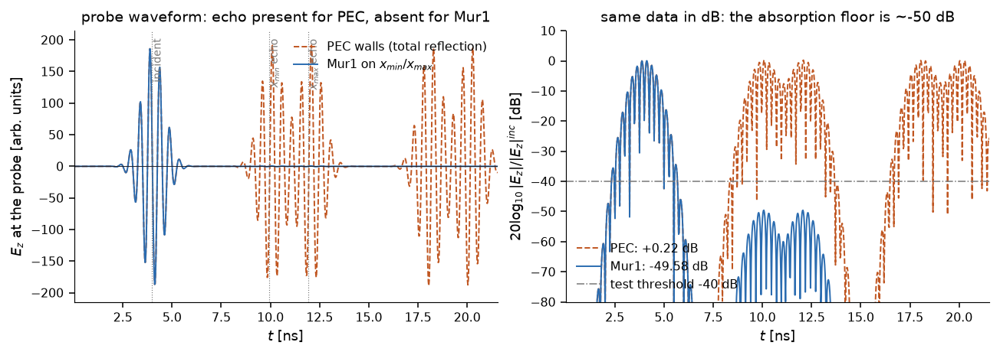
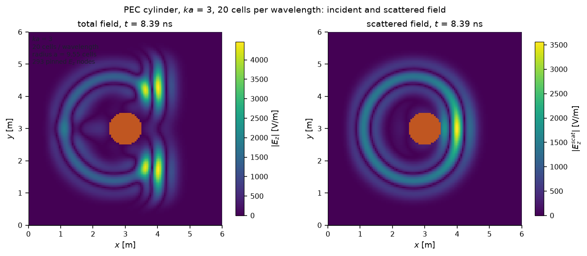
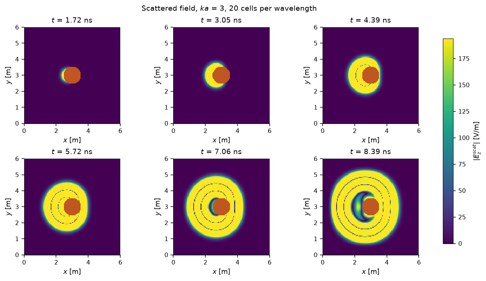
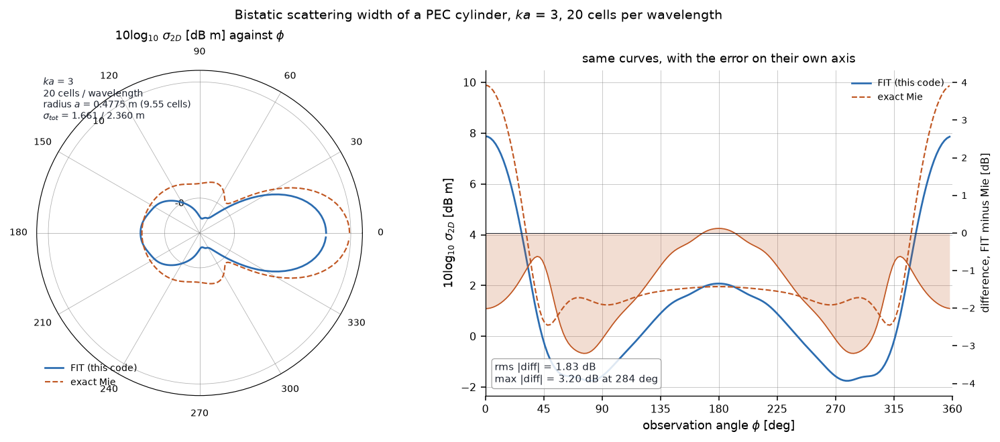
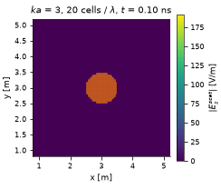

# emfit -- a Finite Integral Technique solver for computational electromagnetics

The Finite Integral Technique (FIT, Weiland) discretises Maxwell's equations on a
pair of interlocked cell complexes instead of on a mesh of elements. **Topology**
-- the incidence matrices `G`, `C`, `S` with entries in {-1, 0, +1}, satisfying
`C G = 0` and `S C = 0` *exactly* -- is strictly separated from **metric**, the
diagonal Hodge stars `M_eps`, `M_mu` that carry every length and area. Non-uniform
grids therefore only change the metric, never the algebra.

This repository is a working 3-D FIT solver: an explicit leapfrog time-domain
integrator with an exactly conserved discrete energy, an eigenmode solver for PEC
cavities validated mode-by-mode against the analytic box spectrum (mean error
0.6-1.2 %, second order, every mode on the low side), absorbing boundaries -- a
first-order Mur condition and a matched PML -- and, on a single cell layer, a
scattering layer with a near-to-far-field transform that reproduces the exact Mie
bistatic RCS of a PEC cylinder to 1.83 dB rms at ka = 3. It is **not** a product
yet: there are no ports and no S-parameters, there is no antenna feed, and the
eigensolver is dense, hence limited to grids with at most 3000 free edges.

## Status

| ID | Milestone | Status | Key deliverable | Acceptance test |
| -- | --------- | ------ | --------------- | --------------- |
| M0 | Time-domain core + cavity eigensolver | DONE | `emfit/{grid,operators,materials,evolve,maxwell,eigen,viz}.py` | 71 passed; mean error 1.213 % / 0.615 %, ratio 0.507 |
| M1 | Absorbing boundaries (Mur, then PML) | IN PROGRESS | Mur-1 (`emfit/abc.py`) and a matched PML (`emfit/pml.py`), both tested and demoed | absorber validated to -79.09 dB at normal incidence (Mur -49.58 dB); the target was PEC-sphere bistatic RCS vs Mie, ka = 1, 3: < 0.5 dB, and what was achieved is a 2-D PEC cylinder at ka = 3: rms 1.83 dB, max 3.20 dB |
| M2 | Near-to-far-field transform and antennas | IN PROGRESS | `emfit/nearfield.py` delivered and validated, with `emfit/mie.py` as the exact reference | no feed and no port, so the half-wave dipole test (73 ohm, 2.15 dBi) is not reachable in the current 2-D TM code |
| M3 | Waveguide ports and S-parameters | PLANNED | `emfit/ports.py` (2-D modal solve, overlaps, de-embedding) | matched WR-90 line: abs(S21) = 1.000, abs(S11) < -30 dB |
| M4 | PCB import from KiCad | PLANNED | `emfit/kicad.py`, `emfit/raster.py` | microstrip Z0 within 5 % of Hammerstad; patch in band |
| M5 | Large-grid eigensolver, thin features, FEM | IN PROGRESS | `emfit/eigen.py`: ARPACK/LOBPCG on the Helmholtz-projected operator | 100k free edges, 6 modes, < 0.1 % vs dense |
| M6 | MQS eddy currents and parareal | PLANNED | `emfit/mqs.py` (A-V), `emfit/parareal.py` | slab skin depth within 2 % of analytic |

This table is identical to the Summary table of [`docs/roadmap.md`](docs/roadmap.md), which
is authoritative. M0 has landed, and its delivered scope also covers the operator and
Hodge-star unit tests, the periodic-axis bookkeeping, the headless visualisation layer
(`emfit/viz.py`), the runnable cavity demo, the study registry with its CLI and browser
front ends, and packaging (`pyproject.toml`).

M1 is in progress, with most of the work landed. A first-order Mur absorbing boundary
(`emfit/abc.py`, class `Mur1Boundary`) is implemented, tested (`tests/test_abc.py`) and
demoed (`examples/abc_duct.py`); a matched lossy layer (`emfit/pml.py`, class `PML`)
now sits beside it. At normal incidence, measured as the two-run difference between the
Mur and PML terminations, the PML reflects at `-79.09 dB` against Mur's `-49.58 dB`.
The Mur duct demo itself still reports `-49.6 dB` at both ends, against a
continuum-dispersion floor of `-49.2 dB` for that discrete guide, with a PEC control at
`+0.21` / `+0.22 dB` and an incident amplitude ratio of `1.000000`. Read that Mur number
as the numerical-dispersion floor of the discrete waveguide, not as a boundary error.

M1's acceptance test was written as "PEC-sphere bistatic RCS vs Mie, ka = 1, 3:
< 0.5 dB", and that is not what was delivered. The validated scattering body is a
**cylinder in 2-D TM**, at ka = 3 only, at **1.83 dB rms** (3.20 dB max). So the
absorber is validated to -79 dB while the Mie target is missed by roughly 1.3 dB rms,
and the radiating test body is a cylinder, not a sphere. Both gaps are stated here
rather than reworded away.

M2 is in progress. The near-to-far-field transform (`emfit/nearfield.py`) is delivered
and validated, and `emfit/mie.py` supplies the exact cylinder series it is checked
against -- see [Scattering and bistatic RCS](#scattering-and-bistatic-rcs-cylinder-versus-mie).
What the original M1 and M2 acceptance tests have in common is an antenna: a feed, a
port, a terminal impedance, a gain pattern. There is no feed and no port in the current
code, and a half-wave dipole is a three-dimensional object, so the `73 ohm, 2.15 dBi`
check is not reachable in the present 2-D TM layer. It stays open, and it is no longer
blocked on numerics -- it is blocked on geometry.

Test suite: **483 tests**, full run **about 13 min**; `-m "not slow"` skips the 14 slow
checks (the two demo solves among them) and gives **469 tests**. That is up from 34
tests at ~30-55 s, and the dense `eigh` of the 14x10x7 cavity grid is no longer the
bottleneck: most of the growth came from cheap checks (operators, periodic axes, near
field, Mie, web front end) alongside a fast PML and scattering path.

## Quick start

```bash
python -m venv .venv && . .venv/bin/activate
pip install -e '.[dev]'

python -m pytest                          # 483 tests, ~13 min (469 with -m "not slow")
python -m emfit list                      # the five packaged studies
python -m emfit run scatter --out docs/figures
python -m emfit run rcs --out docs/figures
python -m emfit serve                     # browser UI on http://127.0.0.1:8010
python examples/cavity_resonance.py       # prints the mode table, writes three PNGs
python examples/abc_duct.py               # Mur duct: prints the end reflections, one PNG
```

`python -m emfit list` shows the five studies: `cavity` (resonances, snapshot, energy),
`modes` (the same box as mode shapes), `duct` (Mur vs PML vs PEC termination of a
pulsed waveguide), `scatter` (a PEC cylinder in a plane-wave-like beam) and `rcs` (the
same cylinder against exact Mie). Any study runs from the command line and every knob
can be overridden:

```bash
python -m emfit run duct --set termination=pml --out /tmp/duct
```

`python -m emfit serve` starts a local, single-user browser front end on
`http://127.0.0.1:8010` -- not 8000, which is the first port every local tool
reaches for and is usually already held; `--port N` moves it and `--port 0` asks
the OS for a free one. Pick a study, edit its parameters, and read the figures
and metrics in the page. Values are validated by `emfit.studies.coerce`, the one place
where strings become typed values, so a bad or out-of-range value is reported and
nothing runs -- from either front end. Measured runtimes: `scatter` 1.4 s (writes
`scatter-snapshot.png` and `scatter-sequence.png`), `rcs` 11.2 s of which 1.57 s is the
time-domain pair (writes `rcs-pattern.png` and `rcs-animation.gif`, 24 frames at 8 fps,
274 KiB), `duct` about 3 s (2.9-3.0 s warm, 4.6 s on a cold page cache).

The cavity demo solves the 10x7x5 eigenproblem of a `1.0 x 0.7 x 0.5 m` PEC cavity and
prints mode index / computed MHz / analytic MHz / relative error; it then rings
the same cavity with a Ricker source for 1800 steps and writes the three PNGs
under `docs/figures/`. Runtime about 6 s.

The duct demo launches a 2 GHz TE10 Gaussian pulse down a PEC duct on 320x16x1 cells,
runs 900 steps and reports the reflection from each Mur-terminated end (`-49.6 dB`) next
to a PEC-terminated control (`+0.2 dB`); it writes `docs/figures/abc_duct.png`.
Runtime about 1.5 s.

## What is implemented

- **`emfit/grid.py`** -- orthogonal (uniform or graded) grids from node
  coordinates: cell and dual widths, edge lengths, face areas, volumes.
- **`emfit/operators.py`** -- `CellComplex`: the metric-free incidence matrices
  `G`, `C`, `S` and their duals, scalar/vectorised index helpers, the PEC
  tangential-edge mask for any subset of the six walls, and the periodic-axis
  seam bookkeeping.
- **`emfit/materials.py`** -- the diagonal Hodge stars `M_eps`, `M_mu`,
  `M_sigma`, plus scalar or per-entity material parameters.
- **`emfit/evolve.py`** -- `FITStepper` (leapfrog, PEC constraint, exact mixed
  state energy, optional PML damping), `RickerSource`, `cfl_dt`, `Leapfrog`
  adapter.
- **`emfit/maxwell.py`** -- `FITSystem`: the same curl-curl system assembled from
  the operators, with PEC walls imposed as a constraint on the unknown space.
- **`emfit/eigen.py`** -- `resonances()`: the pencil
  `C^T M_mu^-1 C e = omega^2 M_eps e` on the free edges, dense solve, gradient
  null space filtered; `analytic_box_modes()` for the PEC box.
- **`emfit/viz.py`** -- matplotlib-Agg-only plotting: spectrum vs analytic,
  field slices, energy and drift. Headless-safe, every helper returns the figure.
- **`emfit/abc.py`** -- `Mur1Boundary`: first-order Mur absorbing edges driven by the
  boundary layer's one-cell history; each tangential edge is owned by exactly one plane
  (xmin, xmax, ymin, ymax, zmin, zmax), so corners and edges are never double-updated.
- **`emfit/pml.py`** -- `PML(grid, thickness_cells, order=2, target=1e-4,
  axes=('x','y'), cc=None)`: a matched lossy layer with `sigma_m/mu0 = sigma_e/eps0`,
  no split fields and polynomial grading, applied as a per-step multiplicative
  damping; `cells_for_wavelength()` turns a target attenuation into a thickness in
  cells.
- **`emfit/scatter.py`** -- 2-D TMz scattering from a PEC cylinder: the PEC mask is
  built from edge coordinates, so the body boundary follows the analytic circle
  instead of snapping to a cell-centre radius; the incident background run is
  subtracted from the total-field run.
- **`emfit/nearfield.py`** -- the near-to-far-field (equivalent-current) transform for
  the 2-D TMz runs: sample a closed contour, fit the exact outgoing Green function on
  the grid, and read the far-field amplitude in every direction from one integral.
- **`emfit/mie.py`** -- the exact 2-D TMz Mie series for a perfectly conducting circular
  cylinder. A reference solution, not a solver.
- **`emfit/studies.py`** -- the study registry: `Param`/`Study` declarations,
  `coerce()` (the single string-to-value gate), metrics, and `FigureSink`, which
  collects PNG bytes plus any extra attachment (the `rcs` GIF).
- **`emfit/cli.py`** -- `python -m emfit list | run | serve`, with distinguishable
  exit codes for scripts.
- **`emfit/webapp.py`** -- the browser front end: `http.server`, one study at a time
  behind a lock, every page self-contained with the PNGs inlined as `data:` URIs.
- **`emfit/_env.py`** -- process-level BLAS thread hygiene, applied before numpy is
  imported: the pencils here are small and dense, so a spinning thread pool only burns
  a contended CPU quota.

## The discretisation in one page

Grid equations (primal edge voltages `e` [V], dual-edge magnetic voltages `h` [A]):

```
C e            = -d/dt (M_mu h)                     Faraday
C^T h          =  d/dt (M_eps e) + j                Ampere
```

Hodge stars -- every length and area lives here, and nothing else:

```
m_eps[e] = eps0 * A~_e / L_e     [F]      m_mu[f] = mu0 * A_f / L~_f     [H]
```

`L_e` is the primal edge length and `A~_e` its dual cross-section; `A_f` is the
primal face area and `L~_f` the dual length. Both stars scale **linearly** with
the cell size, because their units are capacitance and inductance, not lengths.

Leapfrog update, staggered in time:

```
h^(n+1/2) = h^(n-1/2) - dt * M_mu^-1 (C e^n)
e^(n+1)   = e^n       + dt * M_eps^-1 (C^T h^(n+1/2) - j)
```

PEC walls are a *constraint*: the tangential edge voltages are simply not
unknowns, so a zero column of `C` does nothing and no work is silently lost.

Exact discrete invariant at the mixed state `(e^n, h^(n-1/2))`:

```
U = 1/2 e·(M_eps e) + 1/2 h·(M_mu h) - (dt/2) (C e)·h
```

The `-(dt/2)(C e)·h` cross term is not cosmetic: inserting the two update
equations shows it cancels the `O(dt)` defect of the half-step energies, making
`U^(n+1) = U^n` an identity rather than a `dt -> 0` statement. Dropping it, or
using `h` from the wrong time level, gives `O(1)` drift on a random state.

Courant bound, with the *minimum* width on each axis because the shortest edge
controls stability:

```
dt <= safety / ( c0 * sqrt( 1/dx_min^2 + 1/dy_min^2 + 1/dz_min^2 ) ),  safety = 0.99
```

## Validated results

### PEC cavity: spectrum and convergence

PEC box `1.0 x 0.7 x 0.5 m`, all six walls PEC, first six modes [MHz]:

| mode | analytic | 10x7x5 | rel. err | 14x10x7 | rel. err |
| ---- | -------- | ------ | -------- | ------- | -------- |
| 0 | 261.388 | 259.567 | -0.697 % | 260.487 | -0.345 % |
| 1 | 335.178 | 330.518 | -1.390 % | 332.794 | -0.711 % |
| 2 | 368.416 | 363.384 | -1.366 % | 365.863 | -0.693 % |
| 3 | 368.416 | 363.384 | -1.366 % | 365.863 | -0.693 % |
| 4 | 397.743 | 392.852 | -1.230 % | 395.260 | -0.624 % |
| 5 | 397.743 | 392.852 | -1.230 % | 395.260 | -0.624 % |
| mean \|err\| | | **1.213 %** | | **0.615 %** | |
| max \|err\| | | 1.390 % | | 0.711 % | |

The mean-error ratio between the two grids is **0.507**, i.e. `O(h^2)`
convergence for a refinement factor of 1.4 (`1/1.4^2 = 0.51`). Degenerate
TE/TM pairs agree to the printed digit, and every computed mode lies *below* the
analytic one. Rejected spurious modes: 216 and 702, as predicted.


*Lossless ring-down: `U(t)` is flat and its relative drift stays at 8.5e-16 over
343 ns of explicit stepping -- the invariant above is exact to machine precision.*


*Spectrum of the 10x7x5 cavity: measured modes (dots, stems to the reference)
against the analytic `f_mnp` (dashed); every mode is 0.7-1.4 % low.*


*`E_z` on the mid-plane after the Ricker drive, diverging colour scale over
+/-203 V/m, PEC outline drawn: a corner-excited standing pattern, not a plane
wave.*

### Absorbing boundaries: Mur versus the matched PML

The PML (`emfit/pml.py`) is a matched lossy layer rather than a split-field
scheme: electric and magnetic conductivities satisfy `sigma_m/mu0 = sigma_e/eps0`,
so the layer keeps the vacuum impedance and attenuates the wave instead of
scattering it, at every angle of incidence and both polarisations. The discrete
profile uses polynomial grading of order 2 with a peak target of `1e-4`, and it
enters the leapfrog step as a multiplicative damping of `e` and `h` -- no extra
fields, no extra state. `FITStepper` accepts `pml=None`, and that path is asserted
to be *bit-identical* to the old behaviour, so adding the layer changed nothing for
every problem that does not ask for it.

Thickness is a **wavelength law, not a cell count**. `cells_for_wavelength(lam0, h,
target_db=-79)` inverts the measured curve, `lam = 1.0 + (target_db + 52)/-27`, then
rounds up to `ceil(lam*lam0/h)` and floors it at 8 cells. Roughly one wavelength of
layer gives `-52 dB`, roughly two wavelengths gives `-79 dB`, and 20 versus 40 cells
per wavelength at the *same physical* thickness agree to `0.6 dB` -- the cells are
bookkeeping, the wavelengths are the physics.

- Normal incidence, two-run difference: **PML -79.09 dB against Mur -49.58 dB**.
- Reflection stalls near **-45 dB** once the attenuation exceeds about **1.5 Np per
  cell**: more cells or a stronger target stops helping. That is the discrete limit
  of the graded profile, not a tuning failure.
- In the duct study the layer is sized by `_duct_pml_cells(nx, f0, h)` and clipped to
  `[8, nx//4]`. The pytest case for the duct uses a *different* geometry from the
  `-49.58 dB` normal-incidence configuration, and there the numbers are **Mur -26.50
  dB, PML -65.47 dB, margin 38.97 dB**. Do not confuse the two duct setups.
- `--set termination=pml` selects the layer from the command line; the `duct` study
  prints the echo level at both ends (`-78.31 dB` near, `-79.09 dB` far for the
  default PML run) and the measured phase velocity (`1.00693 c`).



*The `examples/abc_duct.py` control run, which is what Mur alone looks like: the
probe waveform near one end, linear and in dB, for a first-order Mur termination
against a PEC wall. The PEC echo returns at the incident amplitude; the Mur echo
sits at the `-49.6 dB` dispersion floor of the discrete guide. The PML is what
removes that remaining floor.*

### Scattering and bistatic RCS: cylinder versus Mie

`emfit/scatter.py` solves 2-D TMz scattering on a single cell layer (`nz = 1`): `Ez`
is a node quantity, and the PEC body is imposed by pinning the `Ez` edges that fall
inside it to zero. The mask is built from **edge coordinates**, so the body boundary
follows the analytic circle rather than snapping to a cell-centre radius. The
scattered field is a pair subtraction: run once with the body, once without, and
subtract.

At `ka = 3` and 20 cells per wavelength: radius `0.4775 m`, **9.55 cells**, **293**
pinned PEC edges against an analytic `286.5` (area ratio `1.023`), 481 steps at
`dt = 9.5329e-11 s`, **1.59 s** for the pair. Peak `|Ez|` is `253.620 V/m` in the
total field and `193.873 V/m` scattered. The number the study prints beside them
is **scattered / incident**, `0.9233`: the scattered peak divided by the
`210.0 V/m` peak of the same pulse in the empty-background run, so the body
radiates within 8 % of the amplitude that illuminates it. Against the *total*
peak the same pair of peaks gives `0.7644`, a different quantity. At 15 cells per
wavelength the mask holds **161** edges against `161.14` analytic -- an *area*
ratio of `0.9991`, a tenth of a per cent short, the staircase error having changed
sign -- and the same scattered-over-incident ratio there is `0.9149` (`191.85`
against `209.7 V/m`), the counterpart of `0.9233`, the coarse mesh resolving the
launched pulse as well as the circle slightly differently.
Two exactness checks pin the bookkeeping down: an empty mask gives a *bitwise zero*
subtracted field, and `|Ez|` on masked nodes is exactly `0.0`.



*Scattered `|Ez|` around the PEC cylinder at `ka = 3`: the total-field run minus the
background run, so this is the field the body itself radiates. The shadow to the
rear and the forward lobe are both visible; the pattern on the illuminated side is
the interference of incident and scattered field.*



*Six snapshots through the 481-step run, in reading order, from pulse arrival to the
steady bistatic pattern -- the same scattered field as above, shown as it develops
rather than as one state.*

One honest caveat belongs next to these numbers: the incident front is
plane-wave-**like**, not plane. The y-PML damps the field inside its own footprint,
so the incident amplitude is not uniform across the corridor; down the centre line
`|Ez|/peak` runs `0.07, 0.58, 1.00, 0.92, 1.00, 0.07`. A PEC y-wall would be worse --
it would build a genuine standing wave instead of rounding the front off. A
total-field/scattered-field injector would fix this properly; it was designed and
deliberately rejected, because the subtraction pair is exact, simple and already
validated, and a TF/SF seam would be a new source of error sitting right on the
contour. The residual it leaves is inside the RCS numbers below.

`emfit/nearfield.py` turns a near-field contour into a far field, and `emfit/mie.py`
provides the exact answer. The transform samples the exact outgoing Green function on
the grid, fits its complex amplitude by least squares, and carries a global `e^(i pi)`:
`a_code = -a_true`. That sign is proven twice, from the asymptotics of the Hankel
function and from an exact no-asymptotics quadrature that returns `-1.000000`, and it
cancels in `|a|^2`, so the RCS is unaffected either way.

The transform is validated on its own terms before it is asked about a body:

- `|a|` is flat to **0.4 %** at 20 cells per wavelength, and the fitted phase slopes
  recover `k*x0` and `k*y0` to **1.6e-3** with the correct signs.
- Convergence laws: relative error about **0.072 (kh)^2**, ripple about **1.15 (kh)^2
  dB**, phase about **6.5 (kh)^2 degrees**.
- The flatness gate passes at **12 cells per wavelength** or finer.

Bistatic RCS of the `ka = 3` PEC cylinder, on a `3.60 x 3.60` wavelength contour,
**2.01 s**:

| angle [deg] | sigma, ours [m] | sigma, Mie [m] | difference [dB] |
| ----------- | --------------- | -------------- | --------------- |
| 0 | 6.1385 | 9.7556 | -2.01 |
| 45 | 0.9531 | 1.1463 | -0.80 |
| 90 | 0.6964 | 1.3352 | -2.83 |
| 135 | 1.2292 | 1.5050 | -0.88 |
| 180 | 1.6133 | 1.5691 | +0.12 |

rms difference **1.830 dB**, worst point **3.202 dB at 284 degrees**. Total scattering
width **1.6610 m** against Mie's **2.3598 m** -- in 2-D the mean over phi *is* the
total, which is why the CLI prints both. The pattern is **not** mirrored: the
forward/back asymmetry has the same sign as Mie's, which a reflection-symmetric bug
would not reproduce. The residual is a broad shadow-side underestimate of roughly
2 dB, attributed to the near-field solve, the staircase body and the finite windowed
beam. It is left visible rather than tuned.



*Our bistatic pattern against exact Mie in polar form, for the `ka = 3` PEC cylinder,
with the dB error on a second axis: the two curves track around the whole circle, and
the error axis shows where and by how much they part.*



*An animated figure: the same comparison as a 24-frame animation at 8 fps (`274 KiB`),
so the pattern and its error against Mie can be followed as the frames advance.*

## Numerical lessons learned

- **The PEC restriction does not remove the gradient null space.** The curl
  restricted to non-PEC edges still has a null space of dimension exactly
  `(nx-1)(ny-1)(nz-1)` (216 for 10x7x5, 702 for 14x10x7). The decisive separator
  is the static eigenvalue cut: the null cluster sits at `1.3e-13 * lam_ref`, the
  fundamental at `3.0 * lam_ref`, so `omega^2 > 1e-10 (pi C0/L)^2` works.
- **A strict divergence residual is not a spuriousness test.** On the restricted
  problem `C_free G_free != 0`, so genuine modes are only approximately
  divergence-free: residual 0.45-0.78 for physical modes versus 2.44-2.48 for
  gradients -- a threshold between two clusters, not a `1e-6` identity.
- **The Hodge stars are not length-invariant.** `m_eps` and `m_mu` both scale
  linearly with cell size (units F and H); a "normalised" star that removes that
  scaling breaks the wave speed.
- **The energy needs its cross term.** Without `-(dt/2)(C e)·h` the drift is
  `3.7e-1`; with `h` from the previous level, `3.4e-1`; with the invariant above,
  `1.3e-15`.
- **The CFL bound uses the minimum cell width and is sharp.** Stable at `1.01x`
  the bound, divergent (`6.7e122`) at `1.02x`; `safety=0.99` is deliberate.
- **FIT resonances converge from below.** Staggered placement makes every discrete
  eigenvalue slightly low, so a mode above its analytic counterpart is a bug
  signal, not dispersion.
- **An absorber's thickness is bought in wavelengths, not cells.** The PML reaches
  `-52 dB` at about one wavelength and `-79 dB` at about two, while 20 and 40 cells
  per wavelength at equal physical thickness agree to `0.6 dB`. Sizing a layer by
  cell count means sizing it by the mesh, which is not what attenuates the wave.
- **A stronger PML is not a better PML.** Reflection stalls near `-45 dB` once the
  attenuation exceeds about `1.5 Np per cell`; beyond that, a larger target or more
  cells makes the discrete profile worse-behaved rather than quieter.
- **In an absorber-truncated problem the incident wave is not the ideal one.** The
  y-PML damps the field inside its own footprint, so the front is plane-wave-like:
  `|Ez|/peak` along the centre line is `0.07, 0.58, 1.00, 0.92, 1.00, 0.07`. That is
  a property of the truncation, not a bug, and it has to be quoted next to any cross
  section measured this way.
- **A pair subtraction needs no seam, and a TF/SF injector is not free.** Running
  the background and subtracting is exact, and bitwise clean on an empty mask; a
  total-field/scattered-field boundary would have to be right to the same standard
  before it earned its extra error term. It was designed and rejected.
- **A global phase does not have to be chased, but it does have to be known.** The
  transform carries `e^(i pi)`, proven from the Hankel asymptotics and from an exact
  quadrature giving `-1.000000`; it cancels in `|a|^2`, so the RCS is unaffected --
  but a sign nobody can derive is an unvalidated sign.

## Repository layout

```
emfit/                 the solver package, 18 modules
├── grid.py            node coordinates, cell widths, edge lengths, face areas
├── operators.py       CellComplex: G, C, S (+ duals), indices, PEC masks, seams
├── materials.py       diagonal Hodge stars M_eps, M_mu, M_sigma
├── evolve.py          FITStepper, RickerSource, cfl_dt, Leapfrog
├── maxwell.py         FITSystem assembly (curl-curl system, PEC constraint)
├── eigen.py           resonance pencil, static-mode filtering, analytic modes
├── viz.py             headless matplotlib figures
├── abc.py             first-order Mur absorbing boundary
├── pml.py             matched lossy layer, wavelength-based sizing
├── scatter.py         PEC cylinder scattering, background/foreground pair
├── nearfield.py       near-to-far-field transform, Green-function fit
├── mie.py             exact 2-D TMz Mie series (reference, not a solver)
├── studies.py         study registry, coerce(), metrics, FigureSink
├── cli.py             python -m emfit list | run | serve
├── webapp.py          local browser front end
├── _env.py            BLAS thread hygiene before numpy import
├── __init__.py
└── __main__.py
tests/                 483 pytest checks: operators, periodic axes, energy,
                       cavity, Mur edge, PML, scattering, near field, Mie, web app
examples/              cavity_resonance.py, abc_duct.py -- end-to-end demos
docs/figures/          8 figures: the 4 committed demo PNGs, plus 2 PNGs from
                       scatter and 1 PNG + 1 animated GIF from rcs
docs/pml_notes.md      working notes on the layer: profile, sizing, limits
docs/report/           LaTeX report: main.tex + 7 sections, compiled main.pdf
pyproject.toml         setuptools packaging, pytest configuration
requirements.txt       pinned floors used in the build container
README.md
```

## Documentation

- `docs/figures/` -- the eight figures embedded above, regenerated by
  `examples/cavity_resonance.py`, `examples/abc_duct.py`, `python -m emfit run
  scatter --out docs/figures` and `python -m emfit run rcs --out docs/figures`.
- `emfit.eigen` raises a `NotImplementedError` that points at milestone M5 for
  grids above 3000 free edges.
- [`docs/roadmap.md`](docs/roadmap.md) -- the authoritative M0-M6 plan: per milestone
  goal, deliverables, measurable acceptance criteria and technical risks.
- [`docs/pml_notes.md`](docs/pml_notes.md) -- the PML working notes: the matched
  profile, the wavelength sizing law, and the measured stall.
- [`docs/report/`](docs/report/) -- the technical report: `main.tex` plus the seven
  `sec_*.tex` sections, with the compiled `main.pdf` (963 KiB) checked in.
- [`docs/HISTORY.md`](docs/HISTORY.md) -- how the machine got here: the order the pieces were
  built in, the measurement that forced each turn, the numbers that were believed and then
  withdrawn, and what the record is evidence for.
- [`docs/OUTLINE.md`](docs/OUTLINE.md) -- the living project outline: milestone tracker,
  numbers board, dated research log with the reasons behind each finding, open questions,
  and the deferred-work list. Its milestone table shares its rows and first five columns
  with the summary table in this README, plus a sixth `Next action` column.

## License

Not yet chosen -- treat the code as all rights reserved until the owner picks a
license.
