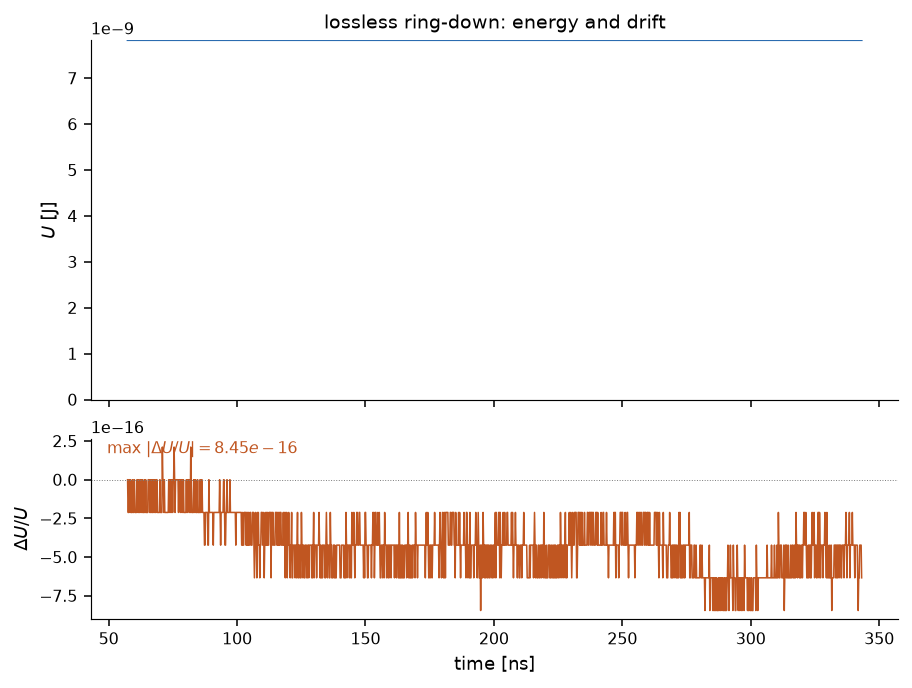
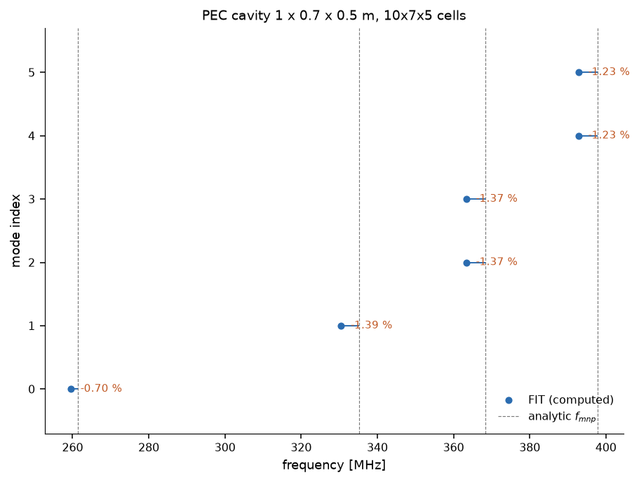
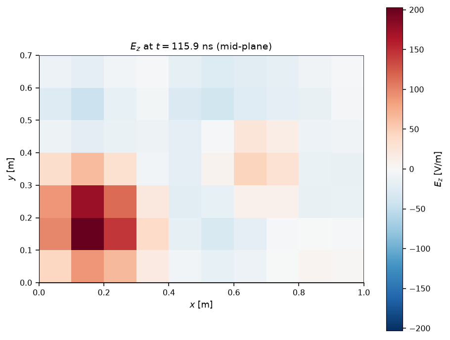

# emfit -- a Finite Integral Technique solver for computational electromagnetics

The Finite Integral Technique (FIT, Weiland) discretises Maxwell's equations on a
pair of interlocked cell complexes instead of on a mesh of elements. **Topology**
-- the incidence matrices `G`, `C`, `S` with entries in {-1, 0, +1}, satisfying
`C G = 0` and `S C = 0` *exactly* -- is strictly separated from **metric**, the
diagonal Hodge stars `M_eps`, `M_mu` that carry every length and area. Non-uniform
grids therefore only change the metric, never the algebra.

This repository is a working 3-D FIT solver: an explicit leapfrog time-domain
integrator with an exactly conserved discrete energy, and an eigenmode solver for
PEC cavities validated mode-by-mode against the analytic box spectrum (mean error
0.6-1.2 %, second order, every mode on the low side). It is **not** a product yet:
the absorbing boundary is first-order Mur only (no PML yet), there are no ports and
no S-parameters, and the eigensolver is dense, hence limited to grids with at most
3000 free edges.

## Status

| ID | Milestone | Status | Key deliverable | Acceptance test |
| -- | --------- | ------ | --------------- | --------------- |
| M0 | Time-domain core + cavity eigensolver | DONE | `emfit/{grid,operators,materials,evolve,maxwell,eigen,viz}.py` | 34 passed; mean error 1.213 % / 0.615 %, ratio 0.507 |
| M1 | Absorbing boundaries (Mur, then PML) | IN PROGRESS | Mur-1 done (`emfit/abc.py`, `tests/test_abc.py`, `examples/abc_duct.py`); remaining: `emfit/pml.py` | PEC-sphere bistatic RCS vs Mie, ka = 1, 3: < 0.5 dB (needs M2 near-to-far field) |
| M2 | Near-to-far-field transform and antennas | PLANNED | `emfit/nearfield.py` (Huygens box -> far field) | half-wave dipole: 73 ohm, 2.15 dBi |
| M3 | Waveguide ports and S-parameters | PLANNED | `emfit/ports.py` (2-D modal solve, overlaps, de-embedding) | matched WR-90 line: abs(S21) = 1.000, abs(S11) < -30 dB |
| M4 | PCB import from KiCad | PLANNED | `emfit/kicad.py`, `emfit/raster.py` | microstrip Z0 within 5 % of Hammerstad; patch in band |
| M5 | Large-grid eigensolver, thin features, FEM | IN PROGRESS | `emfit/eigen.py`: ARPACK/LOBPCG on the Helmholtz-projected operator | 100k free edges, 6 modes, < 0.1 % vs dense |
| M6 | MQS eddy currents and parareal | PLANNED | `emfit/mqs.py` (A-V), `emfit/parareal.py` | slab skin depth within 2 % of analytic |

This table is identical to the Summary table of [`docs/roadmap.md`](docs/roadmap.md), which
is authoritative. M0 has landed, and its delivered scope also covers the operator and
Hodge-star unit tests, the headless visualisation layer (`emfit/viz.py`), the runnable cavity
demo and packaging (`pyproject.toml`).

M1 is in progress. A first-order Mur absorbing boundary (`emfit/abc.py`, class
`Mur1Boundary`) is implemented, tested (`tests/test_abc.py`) and demoed
(`examples/abc_duct.py`): both absorbing ends of a 2-D PEC duct reflect at `-49.6 dB`,
against a continuum-dispersion floor of `-49.2 dB` for that discrete guide, with a PEC
control at `+0.21` / `+0.22 dB` and an incident amplitude ratio of `1.000000`. Read that
number as the numerical-dispersion floor of the discrete waveguide, not as a boundary
error, and note that Mur is **first order**: exact at normal incidence in the 1-D limit,
degrading at oblique incidence and at low frequency, where the local-plane-wave assumption
fails. It is not broadband absorption -- it lets us truncate open problems for the first
time, and a PML is the real broadband answer and remains open. M1's two remaining items
are the PML, blocked on widening `M_eps` / `M_mu` from scalars to diagonal tensors
(anisotropic material support), and a PEC-sphere-vs-Mie RCS validation, blocked on M2's
near-to-far-field transform.

Test suite: **34 tests**, full run **~30-55 s** (of which ~28-42 s, idle to loaded, is the dense `eigh` of the
14x10x7 cavity grid in `tests/test_cavity.py`); the new `tests/test_abc.py` runs in about
1 s.

## Quick start

```bash
python -m venv .venv && . .venv/bin/activate
pip install -e '.[dev]'

python -m pytest                      # 34 tests, ~30-55 s
python examples/cavity_resonance.py   # prints the mode table, writes three PNGs
python examples/abc_duct.py           # Mur duct: prints the end reflections, one PNG
```

The cavity demo solves the 10x7x5 eigenproblem of a `1.0 x 0.7 x 0.5 m` PEC cavity and
prints mode index / computed MHz / analytic MHz / relative error; it then rings
the same cavity with a Ricker source for 1800 steps and writes the three PNGs
under `docs/figures/`. Runtime about 6 s.

The duct demo launches a 2 GHz TE10 Gaussian pulse down a PEC duct on 320x16x1 cells,
runs 900 steps and reports the reflection from each Mur-terminated end (`-49.6 dB`) next
to a PEC-terminated control (`+0.2 dB`); it writes `docs/figures/abc_duct.png`, the fourth
figure. Runtime about 1.5 s.

## What is implemented

- **`emfit/grid.py`** -- orthogonal (uniform or graded) grids from node
  coordinates: cell and dual widths, edge lengths, face areas, volumes.
- **`emfit/operators.py`** -- `CellComplex`: the metric-free incidence matrices
  `G`, `C`, `S` and their duals, scalar/vectorised index helpers and the PEC
  tangential-edge mask for any subset of the six walls.
- **`emfit/materials.py`** -- the diagonal Hodge stars `M_eps`, `M_mu`,
  `M_sigma`, plus scalar or per-entity material parameters.
- **`emfit/evolve.py`** -- `FITStepper` (leapfrog, PEC constraint, exact mixed
  state energy), `RickerSource`, `cfl_dt`, `Leapfrog` adapter.
- **`emfit/maxwell.py`** -- `FITSystem`: the same curl-curl system assembled from
  the operators, with PEC walls imposed as a constraint on the unknown space.
- **`emfit/eigen.py`** -- `resonances()`: the pencil
  `C^T M_mu^-1 C e = omega^2 M_eps e` on the free edges, dense solve, gradient
  null space filtered; `analytic_box_modes()` for the PEC box.
- **`emfit/viz.py`** -- matplotlib-Agg-only plotting: spectrum vs analytic,
  field slices, energy and drift. Headless-safe, every helper returns the figure.
- **`emfit/abc.py`** -- `Mur1Boundary`: first-order Mur absorbing edges driven by the
  boundary layer's one-cell history; each tangential edge is owned by exactly one plane
  (xmin, xmax, ymin, ymax, zmin, zmax), so corners and edges are never double-updated.

## The discretisation in one page

Grid equations (primal edge voltages `e` [V], dual-edge magnetic voltages `h` [A]):

```
C e            = -d/dt (M_mu h)                     Faraday
C^T h          =  d/dt (M_eps e) + j                Ampere
```

Hodge stars -- every length and area lives here, and nothing else:

```
m_eps[e] = eps0 * A~_e / L_e     [F]      m_mu[f] = mu0 * A_f / L~_f     [H]
```

`L_e` is the primal edge length and `A~_e` its dual cross-section; `A_f` is the
primal face area and `L~_f` the dual length. Both stars scale **linearly** with
the cell size, because their units are capacitance and inductance, not lengths.

Leapfrog update, staggered in time:

```
h^(n+1/2) = h^(n-1/2) - dt * M_mu^-1 (C e^n)
e^(n+1)   = e^n       + dt * M_eps^-1 (C^T h^(n+1/2) - j)
```

PEC walls are a *constraint*: the tangential edge voltages are simply not
unknowns, so a zero column of `C` does nothing and no work is silently lost.

Exact discrete invariant at the mixed state `(e^n, h^(n-1/2))`:

```
U = 1/2 e·(M_eps e) + 1/2 h·(M_mu h) - (dt/2) (C e)·h
```

The `-(dt/2)(C e)·h` cross term is not cosmetic: inserting the two update
equations shows it cancels the `O(dt)` defect of the half-step energies, making
`U^(n+1) = U^n` an identity rather than a `dt -> 0` statement. Dropping it, or
using `h` from the wrong time level, gives `O(1)` drift on a random state.

Courant bound, with the *minimum* width on each axis because the shortest edge
controls stability:

```
dt <= safety / ( c0 * sqrt( 1/dx_min^2 + 1/dy_min^2 + 1/dz_min^2 ) ),  safety = 0.99
```

## Validated results

PEC box `1.0 x 0.7 x 0.5 m`, all six walls PEC, first six modes [MHz]:

| mode | analytic | 10x7x5 | rel. err | 14x10x7 | rel. err |
| ---- | -------- | ------ | -------- | ------- | -------- |
| 0 | 261.388 | 259.567 | -0.697 % | 260.487 | -0.345 % |
| 1 | 335.178 | 330.518 | -1.390 % | 332.794 | -0.711 % |
| 2 | 368.416 | 363.384 | -1.366 % | 365.863 | -0.693 % |
| 3 | 368.416 | 363.384 | -1.366 % | 365.863 | -0.693 % |
| 4 | 397.743 | 392.852 | -1.230 % | 395.260 | -0.624 % |
| 5 | 397.743 | 392.852 | -1.230 % | 395.260 | -0.624 % |
| mean \|err\| | | **1.213 %** | | **0.615 %** | |
| max \|err\| | | 1.390 % | | 0.711 % | |

The mean-error ratio between the two grids is **0.507**, i.e. `O(h^2)`
convergence for a refinement factor of 1.4 (`1/1.4^2 = 0.51`). Degenerate
TE/TM pairs agree to the printed digit, and every computed mode lies *below* the
analytic one. Rejected spurious modes: 216 and 702, as predicted.



*Lossless ring-down: `U(t)` is flat and its relative drift stays at 8.5e-16 over
343 ns of explicit stepping -- the invariant above is exact to machine precision.*



*Spectrum of the 10x7x5 cavity: measured modes (dots, stems to the reference)
against the analytic `f_mnp` (dashed); every mode is 0.7-1.4 % low.*



*`E_z` on the mid-plane after the Ricker drive, diverging colour scale over
+/-203 V/m, PEC outline drawn: a corner-excited standing pattern, not a plane
wave.*

## Numerical lessons learned

- **The PEC restriction does not remove the gradient null space.** The curl
  restricted to non-PEC edges still has a null space of dimension exactly
  `(nx-1)(ny-1)(nz-1)` (216 for 10x7x5, 702 for 14x10x7). The decisive separator
  is the static eigenvalue cut: the null cluster sits at `1.3e-13 * lam_ref`, the
  fundamental at `3.0 * lam_ref`, so `omega^2 > 1e-10 (pi C0/L)^2` works.
- **A strict divergence residual is not a spuriousness test.** On the restricted
  problem `C_free G_free != 0`, so genuine modes are only approximately
  divergence-free: residual 0.45-0.78 for physical modes versus 2.44-2.48 for
  gradients -- a threshold between two clusters, not a `1e-6` identity.
- **The Hodge stars are not length-invariant.** `m_eps` and `m_mu` both scale
  linearly with cell size (units F and H); a "normalised" star that removes that
  scaling breaks the wave speed.
- **The energy needs its cross term.** Without `-(dt/2)(C e)·h` the drift is
  `3.7e-1`; with `h` from the previous level, `3.4e-1`; with the invariant above,
  `1.3e-15`.
- **The CFL bound uses the minimum cell width and is sharp.** Stable at `1.01x`
  the bound, divergent (`6.7e122`) at `1.02x`; `safety=0.99` is deliberate.
- **FIT resonances converge from below.** Staggered placement makes every discrete
  eigenvalue slightly low, so a mode above its analytic counterpart is a bug
  signal, not dispersion.

## Repository layout

```
EE/
├── emfit/              the solver package
│   ├── grid.py         node coordinates, cell widths, edge lengths, face areas
│   ├── operators.py    CellComplex: G, C, S (+ duals), indices, PEC masks
│   ├── materials.py    diagonal Hodge stars M_eps, M_mu, M_sigma
│   ├── evolve.py       FITStepper, RickerSource, cfl_dt, Leapfrog
│   ├── maxwell.py      FITSystem assembly (curl-curl system, PEC constraint)
│   ├── eigen.py        resonance pencil, static-mode filtering, analytic modes
│   ├── viz.py          headless matplotlib figures
│   └── abc.py          first-order Mur absorbing boundary
├── tests/              34 pytest checks: operators, energy, cavity, Mur edge
├── examples/           cavity_resonance.py, abc_duct.py -- end-to-end demos
├── docs/figures/       PNGs for the report (generated by the demos)
├── docs/report/        LaTeX report: main.tex + 7 sections, compiled main.pdf
├── pyproject.toml      setuptools packaging, pytest configuration
├── requirements.txt    pinned floors used in the build container
└── README.md
```

## Documentation

- `docs/figures/` -- the three PNGs embedded above plus `abc_duct.png`, regenerated
  by `examples/cavity_resonance.py` and `examples/abc_duct.py`.
- `emfit.eigen` raises a `NotImplementedError` that points at milestone M5 for
  grids above 3000 free edges.
- [`docs/roadmap.md`](docs/roadmap.md) -- the authoritative M0-M6 plan: per milestone
  goal, deliverables, measurable acceptance criteria and technical risks.
- [`docs/report/`](docs/report/) -- the technical report: `main.tex` plus the seven
  `sec_*.tex` sections, with the compiled `main.pdf` (~350 KiB) checked in.
- [`docs/OUTLINE.md`](docs/OUTLINE.md) -- the living project outline: milestone tracker,
  numbers board, dated research log with the reasons behind each finding, open questions,
  and the deferred-work list. Its milestone table shares its rows and first five columns
  with the summary table in this README, plus a sixth `Next action` column.

## License

Not yet chosen -- treat the code as all rights reserved until the owner picks a
license.
